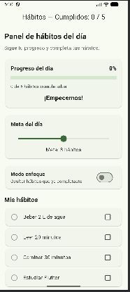
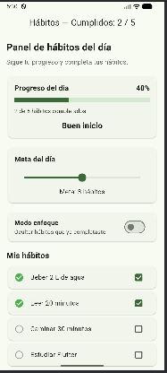
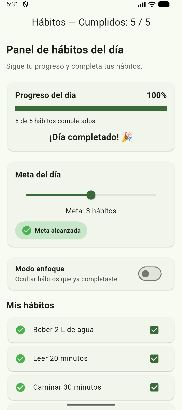
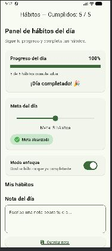

# Panel de Hábitos del Día

Aplicación desarrollada en Flutter para llevar el control de los hábitos diarios de una persona.

La aplicación permite marcar los hábitos completados y actualizar el progreso en tiempo real. También cuenta con una meta diaria, un modo enfoque y un espacio para guardar una nota del día.

## Tecnologías utilizadas

- Flutter
- Dart
- StatefulWidget
- setState()
- Material 3m

## Funcionalidades

La aplicación cuenta con las siguientes funciones:

- Lista de 5 hábitos diarios.
- Checkbox para marcar hábitos como completados.
- Contador de hábitos completados.
- Barra de progreso.
- Mensaje motivacional según el progreso.
- Slider para establecer una meta diaria.
- Indicador de "Meta alcanzada".
- Modo enfoque para ocultar hábitos completados.
- Campo para escribir una nota del día.
- Botón para guardar la nota.
- Botón para reiniciar el día.

## Hábitos incluidos

1. Beber 2 L de agua
2. Leer 20 minutos
3. Caminar 30 minutos
4. Estudiar Flutter
5. Dormir 8 horas

## Variables de estado

| Variable | Descripción |
|---|---|
| `_cumplidos` | Guarda si cada hábito está completado o no. |
| `_meta` | Guarda la cantidad de hábitos establecida como meta del día. |
| `_enfoque` | Controla si está activo el modo enfoque. |
| `_nota` | Guarda la nota escrita por la persona usuaria. |
| `_notaCtrl` | Controla el campo de texto utilizado para escribir la nota. |

## Información calculada

La aplicación utiliza getters para obtener información que depende del estado actual:

- `_totalCumplidos`: cantidad de hábitos completados.
- `_progreso`: porcentaje de progreso del día.
- `_metaAlcanzada`: indica si se alcanzó la meta.
- `_mensaje`: muestra un mensaje dependiendo del porcentaje completado.

## Estados del mensaje

- 0 % → ¡Empecemos!
- 1–49 % → Buen inicio
- 50–99 % → ¡Vas muy bien!
- 100 % → ¡Día completado! 🎉

## Pruebas realizadas

Se verificó el funcionamiento de:

- Marcado y desmarcado de hábitos.
- Actualización del contador.
- Actualización de la barra de progreso.
- Cambio del mensaje motivacional.
- Cambio de la meta mediante Slider.
- Indicador de meta alcanzada.
- Modo enfoque.
- Guardado de notas.
- Reinicio completo del día.
- Desplazamiento de la pantalla.
- Análisis del proyecto con `flutter analyze`.

## Análisis del proyecto

El proyecto fue formateado utilizando:

```bash
dart format .
```

El análisis del proyecto se realizó mediante:

```bash
flutter analyze
```

Resultado:

```text
No issues found!
```

## Capturas de pantalla

Las siguientes capturas muestran diferentes estados y funcionalidades de la aplicación.

### Captura 1 - Inicio



### Captura 2 - Progreso



### Captura 3 - Día completado



### Captura 4 - Modo enfoque



## Reflexión

Durante el desarrollo de la aplicación se comprendió el uso de `StatefulWidget` y `setState()` para manejar información que cambia durante la ejecución de la aplicación.

El uso de variables de estado permitió actualizar diferentes elementos de la interfaz cuando el usuario realiza acciones, como marcar un hábito, cambiar la meta, activar el modo enfoque, guardar una nota o reiniciar el día.

También se comprendió la importancia de utilizar getters para calcular información derivada del estado y mantener el código más organizado.

## Autor

Marcela Pineda